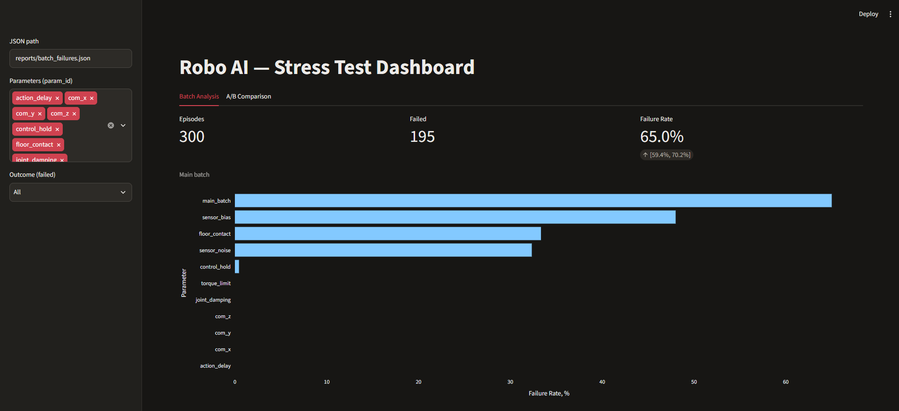
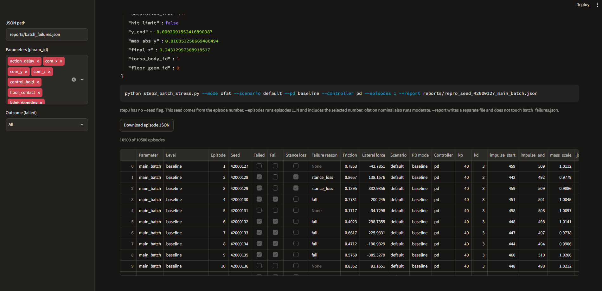
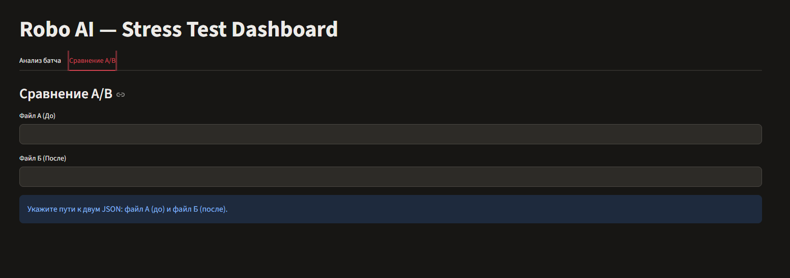

# Robo AI

Robo AI stress-tests robot controllers in MuJoCo before they reach real hardware. It holds a stance across a grid of friction, impacts, and disturbances, records failures, and shows which parameter causes them. An engineer sees the failure rate and can replay one episode or compare two runs.

## Capabilities

- Parallel batch simulation: episodes run in chunks across several processes.
- Stability statistics: failure rate with a 95% Wilson confidence interval, a paired McNemar test, and a Holm correction.
- Failure replay by `seed`: the episode card builds a command for a repeat run.
- A/B comparison of two JSON files on shared `seed`s: discordant pairs `0->1` and `1->0`, the delta in percentage points, and a verdict after Holm.
- A swappable controller: the built-in PD and an external module pass through the same noise, delay, and torque-limit wrappers.

## Installation

```bash
pip install -r requirements.txt
```

## Quick Start

The stress test writes the main batch to `reports/batch_failures.json`:

```bash
python step3_batch_stress.py --mode quick
```

The dashboard starts with the same command. The report path is filled into the sidebar:

```bash
python run_dashboard.py --report reports/batch_failures.json
```

## Dashboard

The main screen puts the batch in one view: how many episodes ran, what share failed, and where the controller loses the stance. Sidebar filters recompute the metrics, charts, and table immediately.



The bar chart shows which parameter produces the most failures. Next to it is the rate with a 95% Wilson interval, so a single failure does not look like a systematic problem.

The heatmap lays the same rate out by parameter level. A green cell holds the stance. A red cell is the level to inspect first.


The table at the bottom is the raw episodes: `seed`, parameter, level, and failure reason. From there an engineer opens one run without losing the rest of the batch.



### Reproducibility

The episode card opens the selected `seed`: parameter, level, the `failed` flag, and the reason. Next to it is a command that can be copied into a terminal.


The dashboard builds the exact CLI command for a local rerun of the failed episode, so an engineer can reproduce and debug it immediately.

### A/B comparison and statistics

Two reports, before and after, are compared only on shared `seed`s. The table shows how many pairs got worse (`0->1`), how many got better (`1->0`), and the delta in percentage points. If `z_ref` or the `seed` sets diverge, the comparison says so.



The built-in paired McNemar test and Holm correction separate a real controller improvement or regression from chance noise.

## Testing

```bash
python -m unittest discover tests
```

## Troubleshooting

If the browser shows `Connection error`, close the tab and start the script again with `python run_dashboard.py`. Ignore the text about `yourscript.py`.
