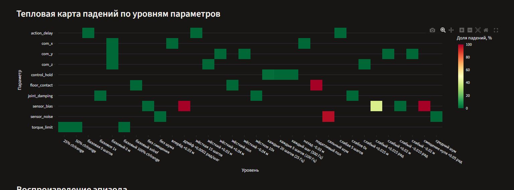
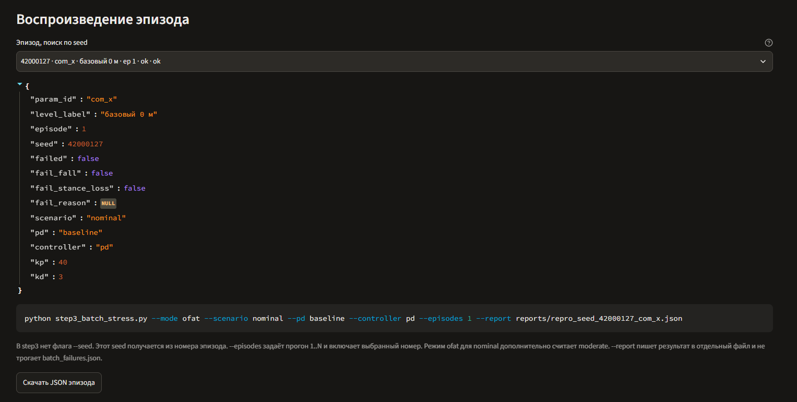

# Robo AI

Robo AI — платформа для стресс-тестирования контроллеров роботов в MuJoCo до выхода на реальное железо. Она гоняет стойку по сетке трения, ударов и возмущений, фиксирует сбои и показывает, какой параметр их вызывает. Инженер видит не только долю падений, но и может воспроизвести конкретный эпизод и сравнить два прогона.

## Основные возможности

- Параллельные симуляции батча: эпизоды считаются чанками в нескольких процессах.
- Статистика устойчивости: доля сбоев с 95% доверительным интервалом Уилсона, парный тест Макнемара и поправка Холма.
- Воспроизведение сбоя по `seed`: карточка эпизода собирает команду для повторного прогона.
- Сравнение A/B двух JSON на общих `seed`: дискордантные пары `0->1` и `1->0`, дельта в процентных пунктах и вердикт после Холма.
- Сменный контроллер: штатный PD и внешний модуль проходят через одни и те же обёртки шума, задержки и ограничения момента.

## Установка (Installation)

```bash
pip install -r requirements.txt
```

## Быстрый старт (Quick Start)

Стресс-тест пишет основной батч в `reports/batch_failures.json`:

```bash
python step3_batch_stress.py --mode quick
```

Дашборд открывается той же командой, путь к отчёту подставляется в сайдбар:

```bash
python run_dashboard.py --report reports/batch_failures.json
```

## Дашборд

Главный экран собирает батч в одну картину: сколько эпизодов прошло, какая доля упала и где именно контроллер теряет стойку. Фильтры в сайдбаре сразу пересчитывают метрики, графики и таблицу.


Бар-чарт показывает, какой параметр даёт больше всего падений. Рядом — доля с 95% интервалом Уилсона, чтобы единичный сбой не выглядел как системная проблема.

Тепловая карта раскладывает ту же долю по уровням параметра. Зелёная ячейка — уровень держит стойку, красная — уровень, с которого стоит начинать разбор.



Таблица внизу — сырые эпизоды: `seed`, параметр, уровень и причина сбоя. Из неё инженер переходит к конкретному прогону, не теряя контекст всего батча.


### Воспроизведение сбоев (Reproducibility)

Карточка эпизода открывает выбранный `seed`: параметр, уровень, флаг `failed` и причину. Рядом лежит команда, которую можно скопировать в терминал.



Дашборд автоматически генерирует точную CLI-команду для локального запуска упавшего эпизода, позволяя инженеру мгновенно воспроизвести и отладить баг.

### Сравнение A/B и статистика

Два отчёта, «до» и «после», сравниваются только на общих `seed`. В таблице видно, сколько пар стало хуже (`0->1`), сколько лучше (`1->0`) и какова дельта в процентных пунктах. Если `z_ref` или набор `seed` разошлись, сравнение честно предупреждает об этом.


Встроенный парный тест Макнемара и поправка Холма помогают отделить реальные улучшения/ухудшения контроллера от случайного шума.

## Тестирование

```bash
python -m unittest discover tests
```

## Troubleshooting (Решение проблем)

Если вы видите ошибку `Connection error` в браузере, просто закройте вкладку и перезапустите скрипт `python run_dashboard.py`. Игнорируйте текст про `yourscript.py`.
